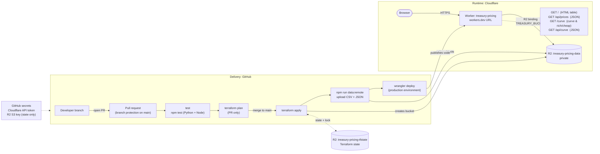

# Treasury pricing

Displays clean price, accrued interest, and dirty price for 353 Treasury notes
and bonds. Prices are dated November 9, 2026, with settlement November 10.
Amounts are per $100 face value. The Worker reads the calculated prices from R2.

## Start here: run on your computer

Open this `assignment_5` folder in VS Code. Run these commands in its terminal.
You need Python 3.10+ and Node.js 22+.

```bash
npm ci
npm run data:local
npm run dev
```

Open the address printed in the terminal, normally <http://127.0.0.1:8787>.
Keep the terminal running; Ctrl+C stops the server. This uses a local R2
simulation and needs no Cloudflare account. The calculated data is included.
After the first setup, run `npm run dev` to return to this local version.

The table comes first, followed by a coupon timeline and four charts: median YTM by remaining maturity, coupon rate versus clean price, coupon rate versus
accrued interest, and counts by maturity year. Click a security to select it;
click a maturity year to filter all views. The table filters apply to every
chart. Settlement stays fixed at November 10, 2026. Page changes appear locally
while Wrangler is running; no data upload is needed for page-only changes.

## Cloudflare R2 setup

**Use the website for account setup, then return to the VS Code terminal.**
Run `npm ci` first if you have just cloned the project.

1. Sign in or create an account at the [Cloudflare dashboard](https://dash.cloudflare.com/).
2. Open **Storage & databases → R2 → Overview** (sometimes labeled
   **R2 Object Storage**). Complete the R2 subscription checkout yourself,
   including any billing information Cloudflare requests. R2 includes free
   monthly usage and bills usage above its allowance.
3. Click **Create bucket**, name it **treasury-pricing-data**, and use
   **Standard** storage. The bucket can stay private.
4. In the VS Code terminal, run:

   ```bash
   npx wrangler login
   ```

   Complete the login and authorization in the browser that opens.
5. Upload the original CSV and calculated JSON to your bucket:

   ```bash
   npm run data:remote
   ```

   In the dashboard, confirm the bucket contains `securityprice.csv` and
   `treasury_prices.json`.
6. Open **Workers & Pages** and look under **Account details → Subdomain**.
   If a `workers.dev` address is already shown, this is set up. Otherwise,
   register an available subdomain there or follow Wrangler's onboarding
   prompt. You do not need to create a separate application in the dashboard
   or buy a domain. The connection to the real bucket requires this account
   setup even when the Worker runs locally. If Wrangler still reports a
   missing subdomain after one appears, retry the command below.
7. Stop any running local server with Ctrl+C, then run:

   ```bash
   npm run dev:cloud
   ```

   Open the printed address. The Worker runs locally but reads your real R2
   bucket. You should see 353 securities and the six required columns.

Once this setup is complete, returning to the cloud-backed page only requires
`npm run dev:cloud`. Login and uploads do not need repeating unless your login
expires or the data changes.

If the page says **"Pricing data could not be loaded"**, check the terminal.
An R2 `get: Unspecified error (0)` can come from the development connection.
Press Ctrl+C, rerun `npm run dev:cloud`, and refresh the page. A connection
restart does not require uploading the files again.

**Wrangler** is Cloudflare's terminal tool; `npm ci` installs it for this
project. `wrangler.jsonc` connects the Worker to the bucket. If you rename
the bucket, change `bucket_name` there too. Keep that file as valid JSON.

The commands select the storage: `dev` and `data:local` use your computer;
`dev:cloud` and `data:remote` use Cloudflare R2. Local uploads do not appear
in your cloud bucket. Registering a subdomain does not deploy this project.

Publishing a URL is optional. Once the real bucket works, run `npm run deploy`.
Wrangler prints the URL. You do not need a custom domain.

Official instructions: [R2 account setup](https://developers.cloudflare.com/r2/get-started/)
and [Workers with R2](https://developers.cloudflare.com/r2/get-started/workers-api/).

## Architecture



The Worker holds no credentials: access to the bucket comes from the binding in
`wrangler.jsonc`. Terraform owns the bucket, Wrangler owns the Worker, and the
data upload runs between them so a deploy never serves an empty bucket.

## Where the files belong

| Location | Purpose |
| --- | --- |
| `src/index.js` | Worker routes and the prices page |
| `src/curve.js` | The `/curve` page: fitted curve, model comparison, rich/cheap, backtest |
| `src/shared.js` | Helpers shared by both pages (escaping, dates, nav, responses) |
| `scripts/` | Download reference data, calculate prices, fit curves, backtest, and upload to R2 |
| `data/raw/` | Original FedInvest CSV; `history/` holds 62 daily FedInvest files (Aug 24 – Nov 20, 2026) |
| `data/reference/` | Treasury terms, coupon schedules, and source URLs; `history/` adds securities that matured during the history window |
| `data/processed/` | Calculated CSV/JSON and validation report |
| `tests/` | Financial calculations and Worker checks |
| `package.json` / `package-lock.json` | Commands and reproducible dependencies |
| `wrangler.jsonc` | Worker and bucket settings |

## Recalculate and check

```bash
npm run prices
npm test
```

After recalculating, run `npm run data:local` or `npm run data:remote` to
update the bucket the page reads. `/api/prices` returns the JSON from R2.

The calculation uses the end-of-day clean quote and actual coupon dates:
`accrued = half-year coupon × days elapsed / days in coupon period`;
`dirty = clean + accrued`. Actual periods can include 183 days as well as
181, 182, or 184. The CSV has no date field, so its price date is supplied
with the assignment. Tests cover month-end, leap years, and settlement timing.

Terms come from [Fiscal Data](https://fiscaldata.treasury.gov/datasets/treasury-securities-auctions-data/)
and [TreasuryDirect](https://www.treasurydirect.gov/auctions/auction-query/).
Saved reference files let calculations run offline. To refresh them, run
`python3 scripts/fetch_reference_data.py --refresh` before recalculating.

YTM is calculated by the Worker from each dirty price and the remaining coupon
payments plus $100 principal, using [Treasury’s price/yield formula](https://www.treasurydirect.gov/files/laws-and-regulations/auction-regulations-uoc/31-cfr-part-356.pdf)
(Appendix B, II.D). It is an annual percentage with semiannual compounding and
actual days for the initial partial period. The chart shows equal-security
medians and the 25th–75th percentile range within maturity buckets, not a
portfolio return or the official Treasury yield curve. YTM fields are added
when serving the page and API; the original R2 files do not need re-uploading.

## Curve and rich/cheap analysis (`/curve`)

The `/curve` page answers which curve model to use, how rich/cheap is measured,
whether cheap securities are really cheap, and what edge that gives. Every
number on it is computed offline by the Python scripts below (standard library
only) and served from `data/processed/curve_page.json` in R2.

| Script | What it does |
| --- | --- |
| `curve_models.py` | Fits six zero-curve models (Nelson-Siegel, NSS, three splines, an overfit spline) to the same bonds and compares them: nested 10-fold CV (interleaved and maturity-blocked), Diebold-Mariano tests, residual clustering, bootstrap stability, forward-curve shape. Splines choose their smoothing penalty by blocked CV. |
| `rich_cheap.py` | Scores every security with the selected model (`--model nss` for the original fit): leave-one-out yield gap to the curve, positive = cheap. |
| `fetch_history_reference.py` | Downloads terms and coupon schedules for securities in `data/raw/history/` that are missing from the Nov 9 reference set. |
| `signal_backtest.py` | Refits every model on each historical day and tests whether scores converge: Fama-MacBeth slopes, a cheap-minus-rich trade net of FedInvest bid/ask, and the same trade entered a day late. |
| `issue_selection.py` | Measures the buy-and-hold edge: yield pickup from buying the cheapest issue in each maturity range, net of purchase cost. |
| `robustness_checks.py` | Smoothing-penalty sweep (interleaved vs blocked CV) and liquidity-factor specifications. |
| `build_curve_page.py` | Combines the outputs into `curve_page.json` and checks they come from the same run. |

```bash
python3 scripts/fetch_history_reference.py   # only when history files are added
npm run curve                                 # all of the above, about 30 minutes
npm run curve:page                            # rebuild curve_page.json only
npm test
npm run data:local                            # or data:remote, then refresh /curve
```

The historical price files were downloaded from FedInvest's historical prices
page through a browser (the site rejects scripted requests); each file is named
by its price date because the CSV has no date column. Nov 20 is excluded by the
backtest because FedInvest had not yet published its end-of-day prices.
